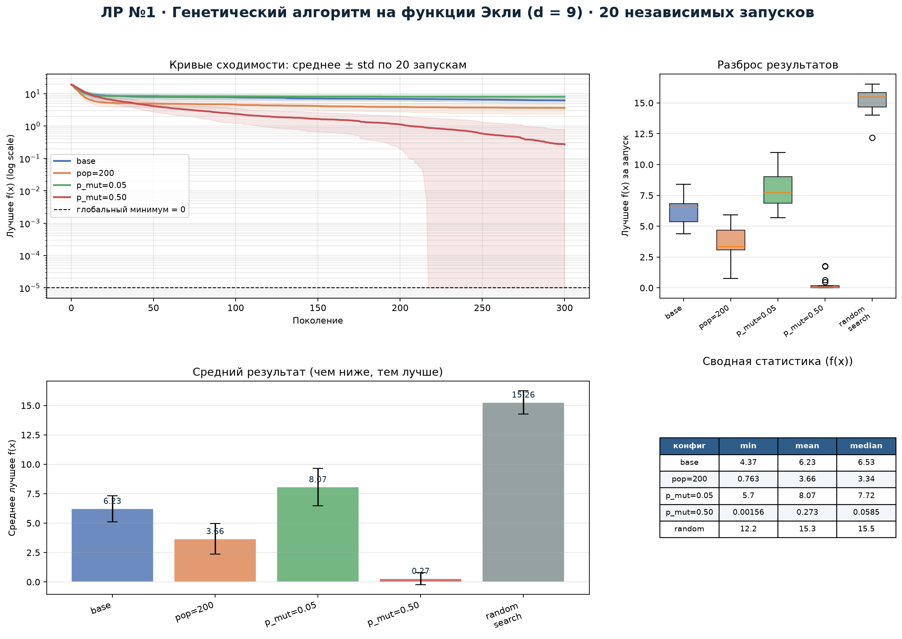
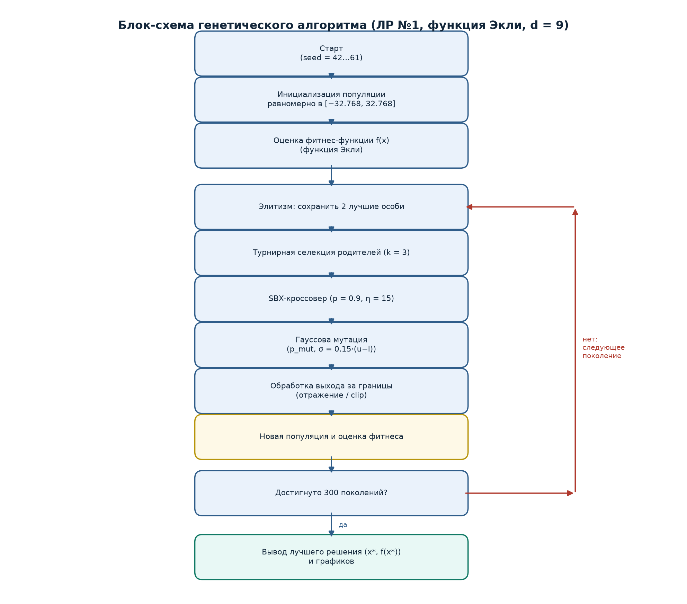
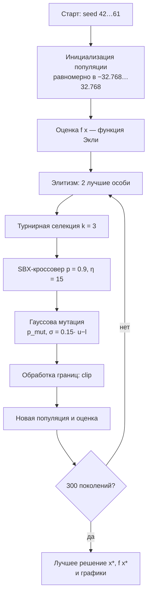
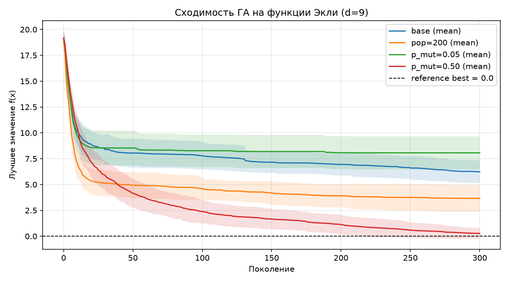
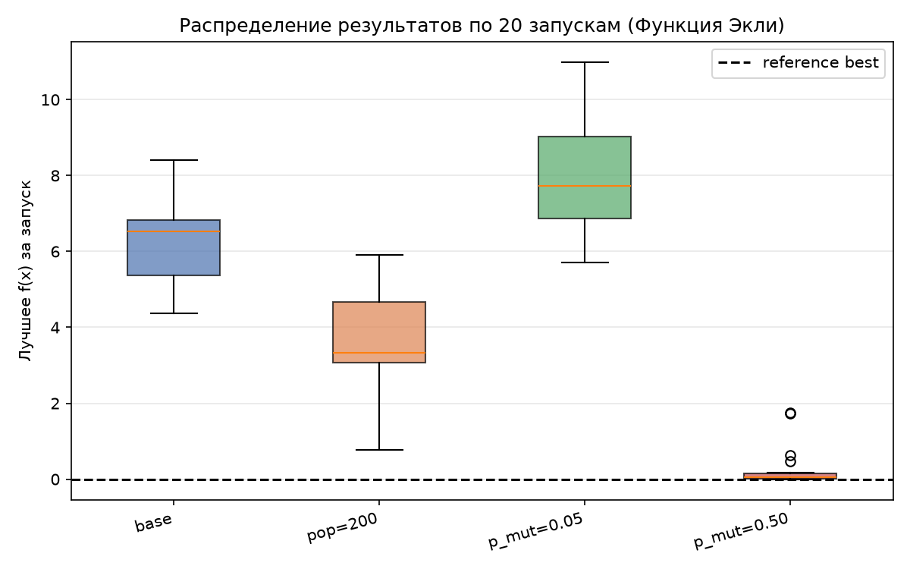

# Лабораторная работа №1
## Многомерная оптимизация функции Экли генетическим алгоритмом


**Студент:** Якимов Максим Андреевич  
**Группа:** Б24-517, № в группе 30  
**Вариант:** 4  
**Дисциплина:** «Эволюционное программирование и генетические алгоритмы»

---

## Дашборд экспериментов



Дашборд собирает в одном изображении кривые сходимости, распределение
результатов, средние значения и сводную таблицу по 20 независимым запускам.

## Блок-схема алгоритма





## Постановка задачи

Найти приближённое глобально оптимальное решение

$$\min_{x\in[-32.768,\,32.768]^9} f(x),$$

где $f(x)$ — функция Экли:

$$f(x)=-20\exp\!\left(-0.2\sqrt{\frac{1}{d}\sum_{i=1}^{d}x_i^2}\right)
-\exp\!\left(\frac{1}{d}\sum_{i=1}^{d}\cos(2\pi x_i)\right)+20+e,$$

$d=5+(4\bmod 6)=9$, глобальный минимум $f(x^*)=0$ в точке $x^*=(0,\dots,0)$.

## Параметры алгоритма

| Параметр | Значение |
|---|---|
| Размер популяции | 100 (`base`, `p_mut=0.05`, `p_mut=0.50`) / 200 (`pop=200`) |
| Число поколений | 300 |
| Селекция | турнирная, $k=3$ |
| Кроссовер | SBX, $\eta=15$, $p_c=0.9$ |
| Мутация | гауссова, $\sigma=0.15(u-l)$, $p_m$ варьируется |
| Элитизм | 2 особи |
| Обработка границ | отражение / clip |
| Seed | 42, серия 42…61 |

## Результаты 20 независимых запусков

| Конфигурация | min | mean | median | std | max |
|---|---:|---:|---:|---:|---:|
| base (pop=100, $p_m=0.2$) | 4.368 | 6.228 | 6.532 | 1.112 | 8.412 |
| pop=200 | 0.763 | 3.660 | 3.340 | 1.298 | 5.911 |
| $p_m=0.05$ | 5.702 | 8.066 | 7.721 | 1.601 | 10.986 |
| **$p_m=0.50$** | **0.0016** | **0.274** | **0.0585** | 0.516 | 1.757 |
| random search | 12.189 | 15.263 | 15.487 | 0.987 | 16.523 |

## Графики

| Сходимость | Сравнение конфигураций |
|---|---|
|  |  |

## Анализ результатов

- **ГА против случайного поиска.** Любая конфигурация ГА, кроме `p_mut=0.05`,
  значительно лучше случайного поиска: лучший результат ГА 0.0016 против
  12.19 у случайной выборки при том же бюджете 30 000 вычислений.
- **Размер популяции.** `pop=200` улучшает среднее с 6.23 до 3.66 за счёт
  большего разнообразия, но требует вдвое больше вычислений на поколение.
- **Вероятность мутации — главный фактор.** `p_mut=0.50` даёт среднее 0.274
  и лучшее 0.0016. При `p_mut=0.05` популяция преждевременно сходится
  (среднее 8.07): крупные гауссовы шаги помогают «выбивать» особей из
  локальных минимумов.
- **Разброс.** У `p_mut=0.50` стандартное отклонение 0.516, но медиана 0.0585
  существенно лучше остальных конфигураций.

## Быстрый запуск

```bash
python -m venv venv
venv\Scripts\activate
pip install -r requirements.txt
python main.py
```

Результаты появятся в `lab1_out/`:

- `lab1_results.csv` — результаты 20 запусков по 4 конфигурациям;
- `lab1_random.csv` — случайный поиск с равным бюджетом;
- `lab1_histories.npz` — траектории сходимости;
- `lab1_convergence.png`, `lab1_comparison.png`;
- `lab1_dashboard.png`, `lab1_block_schema.png`.

## Отчёт

Готовый PDF-отчёт: [`report.pdf`](report.pdf).  
Исходный Markdown: [`report.md`](report.md).

## Структура проекта

```
EvLab_1/
├── main.py              # ГА, эксперименты, графики
├── requirements.txt
├── report.md / report.pdf
├── lab1_out/            # результаты и визуализации
└── README.md
```
